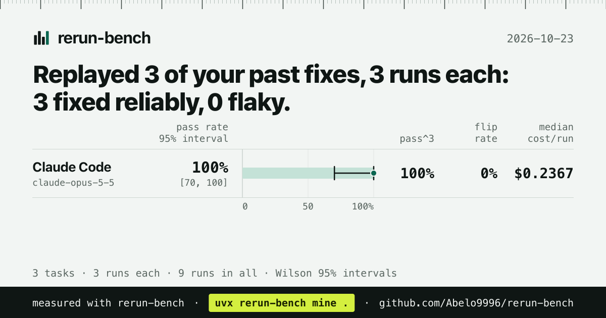

# 2026-10-23: `rerun-bench mine` on two public repositories

A real run of `rerun-bench mine` against Claude Code, replaying each repository's own past
bug-fix commits. It validates the one-call path end to end: mine the git history, build tasks,
run the agent, and lead with the flip.

- Agent: Claude Code 2.1.308, default model (reported as `claude-opus-5-5`).
- 3 mined fixes per repository, 3 runs each (18 agent runs in all).
- Total real cost: $2.98 across the 18 runs.

## Result

Claude Code reproduced all 6 mined fixes reliably. 18 of 18 runs passed, flip rate 0%. No fix
flipped on either repository; when one does, the report shows one passing and one failing run
side by side (diff, failing test output, wall time, tokens).

| Repository | Pass rate | pass^3 | Flip rate | Median cost/run | Median tokens/run | Median wall |
|---|---|---|---|---|---|---|
| [cachetools](https://github.com/tkem/cachetools) | 100% (9/9) [70, 100] | 100% | 0% | $0.2367 | 153,723 | 33.8 s |
| [inflection](https://github.com/jpvanhal/inflection) | 100% (9/9) [70, 100] | 100% | 0% | $0.1136 | 86,218 | 17.0 s |




The 95% interval is wide ([70, 100]) because 9 runs is a small sample; it is not evidence of
flakiness. Raw run records are in `cachetools/runs.jsonl` and `inflection/runs.jsonl`, and each
run's diff is under `<repo>/diffs/<task>/`.

## What was mined and what was skipped

`mine` scans the history for commits that changed source and added or changed a test, then
keeps only those where the test fails on the parent commit and passes on the commit, checked by
running it in a throwaway `git worktree`.

**cachetools** (3 built, 2 skipped of those that reached replay):

- `fix-218` Fix #218: `@cachedmethod.cache_key` handling
- `fix-443` Fix #443: restore autospec calls to `@cachedmethod` decorated methods
- `fix-387` Fix #387: handle `obj=None` in `_DescriptorBase`
- skipped `Fix #405: Cache.__setitem__ over-evicting` and `Reject negative maxsize`: the test
  did not pass when checked out on the fix commit (so the pair could not be isolated cleanly).

**inflection** (3 built, 1 skipped):

- `fix` incorrect pluralisation of "human"
- `fix` `titleize()` capitalizing only words starting A-Z
- `fix` pluralization of "potato"
- skipped `Fix incorrectly sorted imports`: the test already passed on the parent commit, so it
  does not isolate a fix.

## Reproduce

Both libraries are pure Python and their tests run under pytest with no extra dependencies, so
no environment setup was needed beyond pytest on the path.

```sh
uvx rerun-bench mine tkem/cachetools -n 3 --runs 3 --agent claude --yes --card cachetools-card.svg
uvx rerun-bench mine jpvanhal/inflection -n 3 --runs 3 --agent claude --yes --card inflection-card.svg
```

Mining re-clones the repository into a scratch directory and removes it afterwards, so the exact
commits chosen depend on the history at the time; the ranking (clear fix wording, small diffs,
fast tests) is deterministic.
