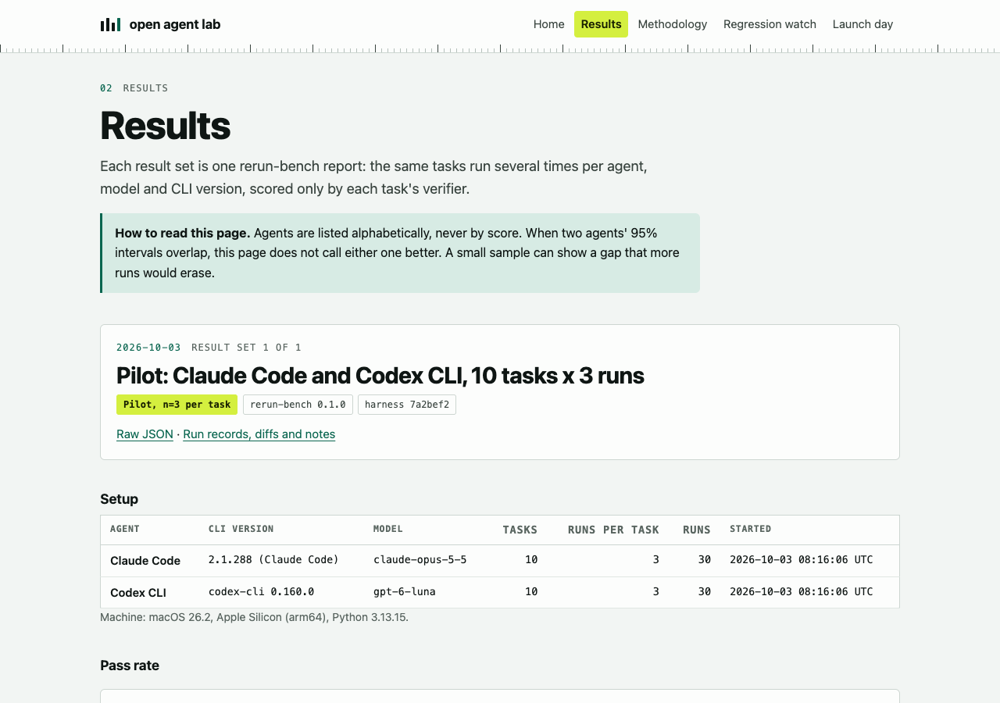

# The rerun-bench lab

The static lab site for [rerun-bench](https://github.com/Abelo9996/rerun-bench). It lives under
`site/` in the rerun-bench repository and deploys to GitHub Pages by the `pages` workflow at the
repository root.

<picture>
  <source media="(prefers-color-scheme: dark)" srcset="docs/results-dark.png">
  <source media="(prefers-color-scheme: light)" srcset="docs/results-light.png">
  
</picture>

An independent, reproducible evaluation lab for coding agents (Claude Code, Codex CLI,
OpenCode, DeepSeek Harness and others). It reruns the same coding tasks many times per
agent, model and CLI version, and publishes pass rates with confidence intervals,
consistency across reruns, and cost and token spread.

Site: https://abelo9996.github.io/rerun-bench/

The site and its data live here under `site/`. Every number on the site comes from a
JSON file under [`data/`](data/). The plugin marketplace and the nerf-watch regression intake
stay in [open-agent-lab](https://github.com/Abelo9996/open-agent-lab), because published
nerf-watch versions open their issues there.

## What is here

| Path | What it is |
|---|---|
| `data/results/<YYYY-MM-DD>-<label>.json` | One result set each: a rerun-bench JSON report, optionally with a `lab` block of metadata. |
| `data/regressions.json` | Regression watch data: hand-reviewed `reports`, plus `aggregates` that the pages workflow fills from open regression-report issues in open-agent-lab at build time. |
| `data/launches.json` | Launch-day log: model launches and the result sets published for them. |
| `data/agents.json` | Display names and links for agent ids used in result files. |
| `data/tasks.json` | The task suite (ids, titles, tags, timeouts), copied from rerun-bench. |
| `scripts/build.mjs` | Builds `_site/` from `data/`. No dependencies. |
| `scripts/validate.mjs` | Validates every data file. CI runs it on every pull request. |
| `scripts/aggregate-regressions.mjs` | Validates and aggregates open-agent-lab's regression-report issues into `data/regressions.json`. The pages workflow runs it before every build and hourly. |
| `src/` | Stylesheet, the page script (tooltips, theme, copy buttons, demo playback, chart entrance), the favicon, the tool demo recordings and still frames, and the social preview image, copied to `_site/assets/`. |
| `scripts/social.mjs` | Renders `src/social-preview.png` (and `docs/social-preview.png`) from the latest result set with headless Chrome. |

## The tools behind it

- [rerun-bench](https://github.com/Abelo9996/rerun-bench): runs the same tasks N times per
  agent and reports pass rate with a Wilson interval, pass^k, flip rate, and cost and token
  spread. It produces every result set here. Metric definitions:
  [docs/METRICS.md](https://github.com/Abelo9996/rerun-bench/blob/main/docs/METRICS.md).
  Try it free with the mock agent: `uvx rerun-bench run --agent mock`.
- [nerf-watch](https://github.com/Abelo9996/nerf-watch): local-first detector of silent model,
  effort, token and cost changes in agent logs: `npx nerf-watch check`. `npx nerf-watch share`
  prints the anonymized JSON a regression report contains and a prefilled issue link.
- [snap-back](https://github.com/Abelo9996/snap-back): undo for any coding agent:
  `npx @abelo9996/snap-back wrap -- codex`, or `npm install -g @abelo9996/snap-back`.
- [agent-fence](https://github.com/Abelo9996/agent-fence): one permission policy for any agent:
  `npm install -g @abelo9996/agent-fence`.
- [launch-day-kit](https://github.com/Abelo9996/launch-day-kit): playbook, templates and a
  scaffolder for shipping a companion repo within hours of a platform launch:
  `git clone https://github.com/Abelo9996/launch-day-kit`.

Each tool has a section on the home page with its install command and a terminal recording,
linked by name: [#nerf-watch](https://abelo9996.github.io/rerun-bench/#nerf-watch),
[#rerun-bench](https://abelo9996.github.io/rerun-bench/#rerun-bench),
[#snap-back](https://abelo9996.github.io/rerun-bench/#snap-back),
[#agent-fence](https://abelo9996.github.io/rerun-bench/#agent-fence),
[#launch-day-kit](https://abelo9996.github.io/rerun-bench/#launch-day-kit).

## Install the tools as agent plugins

The plugin marketplace lives in [open-agent-lab](https://github.com/Abelo9996/open-agent-lab).
Add it once, then install the tools you want from inside the agent.

Claude Code:

```text
/plugin marketplace add Abelo9996/open-agent-lab
/plugin install nerf-watch@open-agent-lab
/plugin install snap-back@open-agent-lab
/plugin install agent-fence@open-agent-lab
/plugin install rerun-bench@open-agent-lab
```

Codex:

```sh
codex plugin marketplace add Abelo9996/open-agent-lab
codex plugin add nerf-watch@open-agent-lab   # also snap-back, agent-fence, rerun-bench
```

Each plugin brings the tool's skill. In Claude Code they also add slash commands
(`/nerf-watch:check`, `/nerf-watch:share`, `/snap-back:undo`, `/snap-back:list`,
`/snap-back:status`, `/agent-fence:explain`, `/agent-fence:log`, `/rerun-bench:run-mock`,
`/rerun-bench:report`), and snap-back and agent-fence ship their hooks, so no settings file is
edited. The agent-fence Codex plugin ships its hook too, which Codex runs after you trust it in
`/hooks`. The plugins run each CLI through `npx` or `uvx`; each tool's README covers the
details. The catalogs live in the open-agent-lab repository.

## Add a result set

1. Run rerun-bench with at least 3 runs per task (for example
   `uvx rerun-bench run --agent claude --runs 3 --out results/`), then
   `uvx rerun-bench report results/ --format json -o report.json`.
2. Copy the file to `data/results/<YYYY-MM-DD>-<label>.json`, where the date is the day the
   runs started (UTC) and the label is lowercase letters, digits and hyphens.
3. Optionally add a `lab` block (title, pilot flag, notes, links). See
   [CONTRIBUTING.md](CONTRIBUTING.md#the-lab-block).
4. `npm run validate && npm run build`, then open a pull request. When it merges to `main`,
   the pages workflow rebuilds and deploys the site.

A file straight from `rerun-bench report --format json` validates without any edits.

## Run locally

Requires Node.js 20 or newer. There is nothing to install.

```sh
npm run validate   # check data/
npm test           # validator, regression aggregator and built-page tests
npm run build      # write _site/
npm run serve      # preview at http://localhost:8080/
npm run social     # re-render the social preview image (needs Chrome)
```

The pages work without JavaScript and with `prefers-reduced-motion: reduce`: every number,
chart mark and demo still frame is final in the HTML, and animation is layered on top.

## How results are presented

- Agents are listed alphabetically. There is no rank column.
- When two agents' 95% intervals overlap, the site says the data does not show a difference.
- Sample size is shown on every result set, and pilot runs are labeled as pilots.
- Values a CLI does not report are shown as not reported, never as zero.

## License

Code: MIT, see [LICENSE](LICENSE). Data under `data/`: CC BY 4.0.
